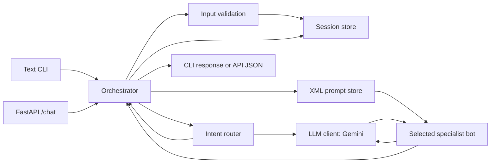

# Architecture

## Components

- **Interfaces:** [`app/cli.py`](../app/cli.py) implements the interactive
  terminal chat. [`app/main.py`](../app/main.py) exposes the HTTP API. Each
  constructs its own orchestrator and session store.
- **Orchestrator:** [`app/orchestrator.py`](../app/orchestrator.py) validates
  input, requests a routing decision, records conversation state, loads the
  specialist prompt, invokes the selected bot, and records the reply.
- **Intent router:** [`app/router.py`](../app/router.py) asks the LLM to select
  a specialist and score the relevance of prior context. The structured
  decision contains a target, confidence, reason, and relevant message
  indices.
- **Specialist bots:** Sales, personal-loan, and gold-loan bots share the
  [`BaseBot`](../app/bots/base.py) interface and use the same injected LLM
  client.
- **Prompt store:** [`app/prompt_store/`](../app/prompt_store/) reads XML files
  from [`app/prompts/`](../app/prompts/), validates their IDs and versions,
  parses their sections, and formats prompt text.
- **Session store:** [`app/memory.py`](../app/memory.py) keeps active-bot state,
  full message history, and selected context in process memory.
- **LLM adapter:** [`app/llm/base.py`](../app/llm/base.py) defines the
  `LLMClient` contract. [`app/llm/gemini_client.py`](../app/llm/gemini_client.py)
  is the implemented Gemini adapter.

## Request flow

The first message for a session starts with the `sales` bot active. Each
message is routed using the active bot and the session's selected context. The
orchestrator logs the routing decision and logs a handoff only when the target
specialist differs from the current one.

## Specialist routing

The router asks the LLM for a structured `RoutingDecision`: one of `sales`,
`personal_loan`, or `gold_loan`, a reason, confidence from 0 to 1, and
zero-based references to relevant prior messages with relevance scores.
Ambiguous or unrelated requests are instructed to remain with the active bot.

The orchestrator includes selected prior messages with relevance scores of at
least 0.5 in memory passed to the specialist. It merges unique messages and
keeps the most recent 20 selected messages. Full history remains separately
available to the CLI's `/history` command.

## XML prompt store

Each specialist has a versioned XML prompt under `app/prompts/`; the XML
`id` must match its filename and the prompt ID requested by the orchestrator.
The parser reads section text, and the formatter includes the `role`,
`objective`, `instructions`, and `response_guidelines` sections in the
specialist's system prompt. Extra XML sections are not included by the current
formatter.

The orchestrator logs the prompt ID and version selected for each request.
Prompt files are read from the relative path `app/prompts`, so start the
application from the repository root.

## Session memory

Session data is an in-memory dictionary keyed by session ID. It includes the
active specialist (initially `sales`), all user/assistant messages, and
selected context. It is not saved to disk or a database. State is lost when
the process stops and is not shared between separate CLI and API processes.
For the API, one module-level store is reused by requests handled by that
process.

## LLM abstraction

The `LLMClient.generate` interface accepts a system prompt, latest message,
history, and an optional Pydantic response schema. Gemini implements this
interface and is used both for structured routing and specialist responses.
The interface provides a seam for another adapter, but no local-model or
alternative-provider adapter is currently present.

## Key decisions and trade-offs

- **One orchestration path:** CLI and API delegate behavior to the same
  orchestrator implementation, avoiding divergent routing logic. They still
  construct separate process-local instances.
- **Separate interfaces:** The text CLI and FastAPI service can be run and
  inspected independently. Their session state is not shared across processes.
- **Central XML prompts:** Specialist instructions can be edited without
  changing bot classes. XML is loaded from disk on each use; the current
  implementation does not persist prompt data in a database.
- **Bounded, process-local context:** Selected context is kept to 20 messages
  and input lengths are bounded. This is simple for a single process but does
  not provide durable memory or coordinated state across workers.
- **Cloud LLM adapter:** Gemini avoids operating a model locally, but requires
  a Gemini API key, network access, and external model requests. No offline
  local model implementation is provided.

See [Design decisions](decisions.md) for implemented status and items not
currently implemented.
